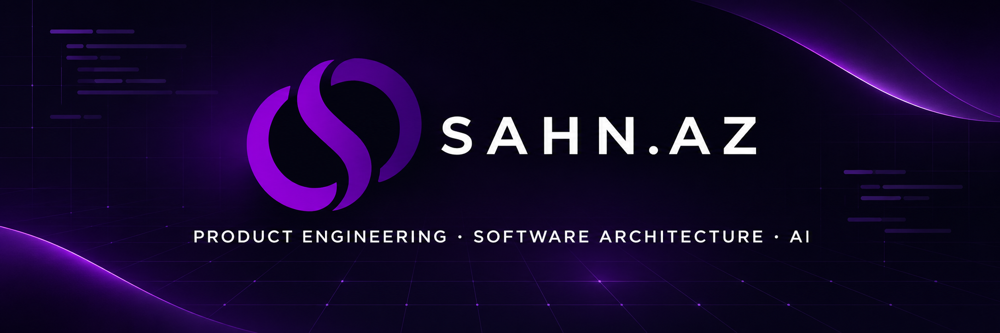

# Taleh Maharramov

**Senior Full-Stack Developer · Product Engineer**

I design and build production-ready digital products — from backend architecture and APIs to polished, high-performance user experiences. I focus on maintainable systems, measurable business outcomes, and pragmatic engineering.

- Building scalable applications with **PHP, Laravel, JavaScript, TypeScript, React, and modern CSS**
- Designing **REST APIs, relational data models, background jobs, caching, and third-party integrations**
- Shipping multilingual platforms, internal tools, automation, and AI-enabled products
- Improving systems through performance engineering, SEO, security, testing, and thoughtful refactoring

## Selected work

| Product | Engineering focus |
| --- | --- |
| [Sahn Invitation](https://sahninvite.com) | Digital invitation and event experience platform with premium templates, RSVP, guest messaging, maps, media, and shareable event pages |
| [Sahn Invitation Panel](https://panel.sahninvite.com) | Customer dashboard and event management system built around React, TypeScript, Laravel APIs, content tooling, guest management, and operational workflows |
| [Hadron Lights](https://hadronlights.com) | Responsive lighting product catalog and administration platform focused on structured product discovery, multilingual content, and maintainable operations |

## Core engineering areas

```text
Product architecture · Laravel · PHP · TypeScript · React
REST APIs · PostgreSQL · Redis · Queues · Integrations
Performance · Security · Technical SEO · CI/CD · AI automation
```

## Engineering principles

- Clarity over cleverness
- Small, reviewable changes
- Production behavior over local assumptions
- Security, observability, and performance by design

## Connect

- Portfolio: [sahn.az](https://sahn.az)
- LinkedIn: [Taleh Maharramov](https://www.linkedin.com/in/talehmaharamov/)
- X: [@talehmaharamov](https://twitter.com/talehmaharamov)

Open to technically ambitious products, long-term collaborations, and engineering challenges.
